# Galé: disk bebidas com vitrine, delivery e gestão completa

O Galé é o sistema de uma distribuidora de bebidas de bairro, em Ituiutaba (MG). Ele cobre a operação inteira de ponta a ponta:

- **o cliente** abre a vitrine, monta o carrinho, paga com pontos e acompanha o pedido;
- **o balcão** registra vendas, separa e despacha entregas;
- **o dono** controla estoque, preço, margem, fiado, programa de fidelidade e resultado do mês.

> Todas as telas abaixo são prints reais do sistema rodando, com dados de teste.

---

## Sumário

1. [O que o sistema se compromete a fazer](#1-o-que-o-sistema-se-compromete-a-fazer)
2. [Como foi pensado: os princípios por trás](#2-como-foi-pensado-os-princípios-por-trás)
3. [Área pública e do cliente](#3-área-pública-e-do-cliente)
4. [Painel administrativo](#4-painel-administrativo)
5. [Regras de negócio em detalhe](#5-regras-de-negócio-em-detalhe)
6. [Tecnologia e como rodar](#6-tecnologia-e-como-rodar)

---

## 1. O que o sistema se compromete a fazer

| Compromisso | Como o sistema cumpre |
|---|---|
| **Vender só o que existe** | O catálogo só mostra o que tem em estoque. Cada venda baixa o estoque na hora, sempre dos lotes mais antigos primeiro (FIFO). |
| **Saber o lucro de verdade** | Cada item vendido guarda o custo real do lote de onde saiu, já com frete e taxas da compra rateados. Com isso o sistema mostra o lucro por venda, por dia de trabalho, por produto e por mês. |
| **Cobrar o preço certo, sozinho** | O preço muda conforme o contexto: normal, noturno, atacado, liquidação ou iFood. A conta é feita no servidor, nunca no navegador. |
| **Não perder entrega** | Todo pedido de delivery passa por um quadro Kanban, de "Recebido" até "Entregue". Há mapa das entregas, motoboy por pedido e rota pronta no Google Maps. |
| **Controlar o fiado (notinha)** | Só compra fiado quem foi autorizado, e cada cliente tem um limite. Quando a conta é fechada atrasada, os juros ficam registrados à parte. |
| **Fidelizar sem quebrar o caixa** | O programa de pontos tem rede de indicação e títulos. Uma trava impede salvar uma regra que distribua mais do que o lucro aguenta. |
| **Fechar o mês como um contador** | A DRE é feita pelo regime de caixa, com taxa de cartão, Simples Nacional, CMV e despesas fixas. |

---

## 2. Como foi pensado: os princípios por trás

Estas ideias aparecem em todas as telas e explicam a maior parte das decisões.

1. **O servidor é quem manda no dinheiro.** Preço, desconto em pontos, frete, dono do pedido e origem da venda são sempre recalculados no backend. O navegador mostra uma prévia, mas o valor cobrado é o que o servidor calcula. Assim, ninguém altera um preço pela ferramenta de desenvolvedor do navegador.

2. **O passado não se reescreve.** O nome do produto, a taxa da maquininha e o custo do lote são *congelados* no momento da venda. Se a taxa de crédito mudar amanhã, o faturamento de ontem continua igual. Se o produto for renomeado, o histórico mostra o nome que ele tinha quando foi vendido.

3. **Uma regra, um lugar só.** Por exemplo, a mesma configuração de pontos alimenta três coisas: o cálculo, a página pública que explica o programa e o botão "Restaurar padrão". Se a página explicasse números de um lugar e o cálculo pagasse por outro, o problema deixaria de ser técnico e viraria jurídico.

4. **A trava falha fechada.** Quando uma verificação de segurança não consegue calcular (um campo faltando, uma configuração corrompida), ela trata o caso como estouro e bloqueia. Uma trava que se cala diante do inesperado não é uma trava.

5. **Explicar em vez de esconder.** Quando uma opção não está disponível, a tela diz o porquê. Exemplos: a notinha que estourou o limite, o pedido que não aceita mais itens, o endereço que o mapa não encontrou. Uma opção que simplesmente some gera confusão e chamado de suporte.

6. **O Admin sempre consegue trabalhar.** Mesmo com a loja fechada, o Admin vende. A venda fica "sem dia de trabalho" e é puxada para o próximo dia quando a loja abrir.

---

## 3. Área pública e do cliente

### 3.1 Vitrine (o que o visitante vê ao entrar)

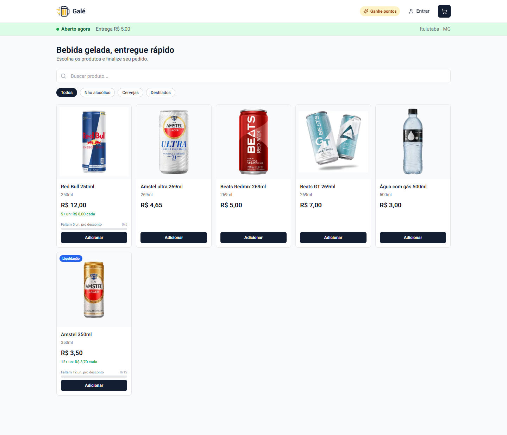

A página inicial já é a loja.

- **Faixa verde no topo:** mostra se a loja está aberta, o valor da entrega e a cidade. São as três dúvidas de quem quer pedir bebida agora.
- **Filtros e busca:** os filtros por categoria são criados a partir dos produtos que existem; a busca é por nome.
- **Desconto por quantidade nos cards:** o card mostra a regra ("5+ un: R$ 8,00 cada") e uma barra de progresso ("Faltam 4 un. pro desconto"). A barra empurra o cliente para a caixa fechada, que é a venda mais lucrativa.
- **Selo "Liquidação":** marca produtos que estão saindo a preço de custo para girar o lote.

**Por quê:** o visitante pode navegar sem conta. A conta só é exigida no checkout, porque pedir cadastro antes de mostrar o preço afasta quem só queria saber quanto custa uma cerveja.

### 3.2 Página pública do programa de pontos

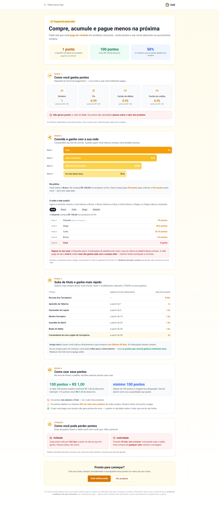

Explica o programa em quatro passos, com exemplos numéricos:

1. **Como ganhar.** Os pontos dependem da forma de pagamento: dinheiro dá 1 ponto por real, Pix 0,99, cartão 0,95. O frete não gera pontos.
2. **A rede de indicação.** Quem indica ganha sobre a compra dos indicados, até 4 níveis. O exemplo "Você → Bruno → Carla → Diego → Eduarda" mostra que **é a distância até quem compra que decide**, e não o tamanho da sua rede.
3. **Os títulos.** São 7 degraus, de *Recruta dos Cervejeiros* (0,99x) até *Comandante de uma Legião de Cervejeiros* (2x), conforme a quantidade de amigos ativos.
4. **Como usar.** 100 pontos valem R$ 1,00. É preciso ter no mínimo 100 pontos para usar, e eles abatem no máximo 50% dos produtos. O frete nunca é abatido.

Também há uma seção **"Como você pode perder pontos"**: cada ponto vale 365 dias, e 90 dias sem comprar zeram o saldo.

**Por quê:** os números exibidos vêm da mesma configuração que o motor usa para calcular. O prazo da notinha *não* aparece nesta página de propósito. Como ela é pública, o nome do campo já revelaria que existe compra fiado, e esse é um benefício liberado individualmente.

### 3.3 Login, recuperação de senha e cadastro

| Login | Esqueci minha senha | Cadastro |
|---|---|---|
| 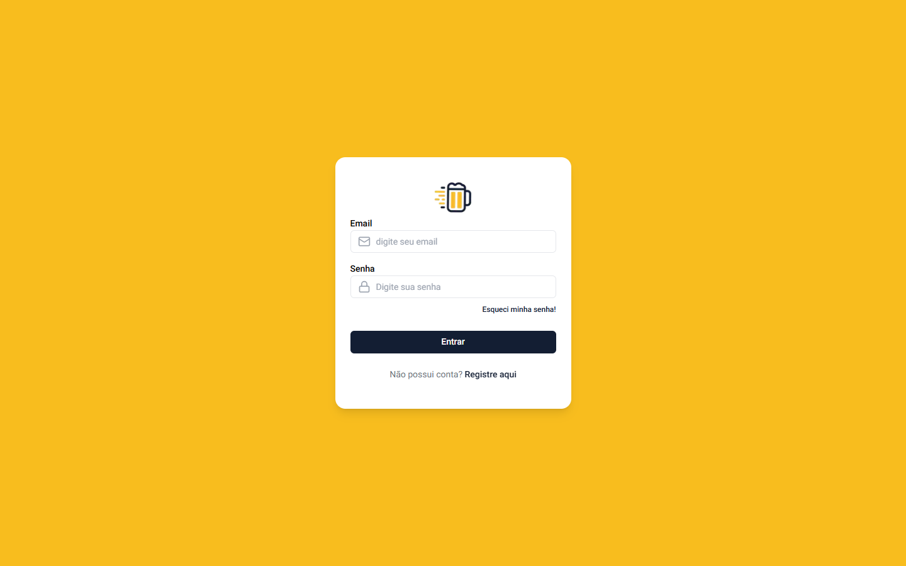 | 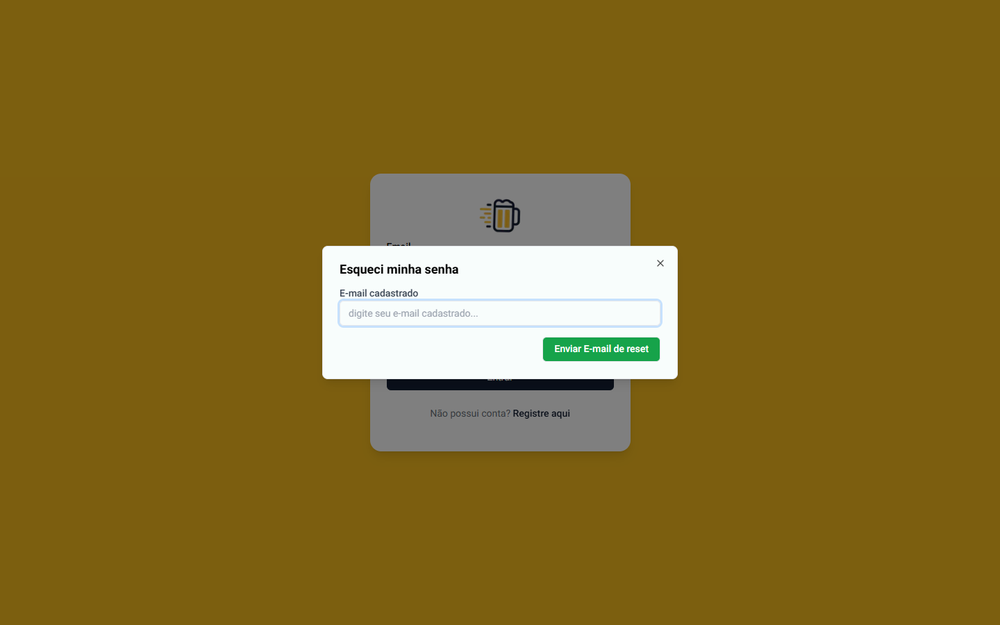 | 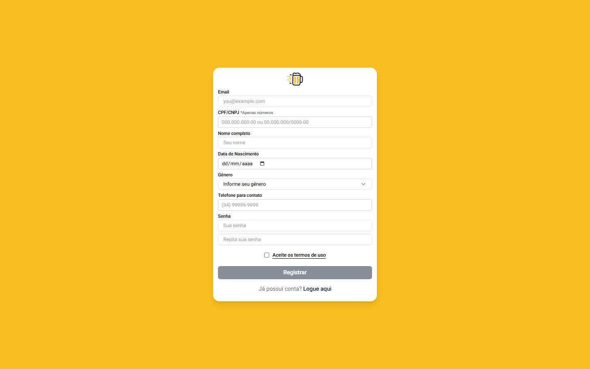 |

- **Cadastro:** pede CPF/CNPJ, que é validado; data de nascimento, porque só maiores de 18 anos compram bebida alcoólica; e confirmação de e-mail.
- **Link de convite:** o cadastro aceita `?ref=CODIGO`. É assim que a pessoa entra na rede de quem a convidou.
- **Recuperação de senha:** é feita por e-mail, com um link temporário.

### 3.4 Carrinho e checkout

| Carrinho | Checkout |
|---|---|
| 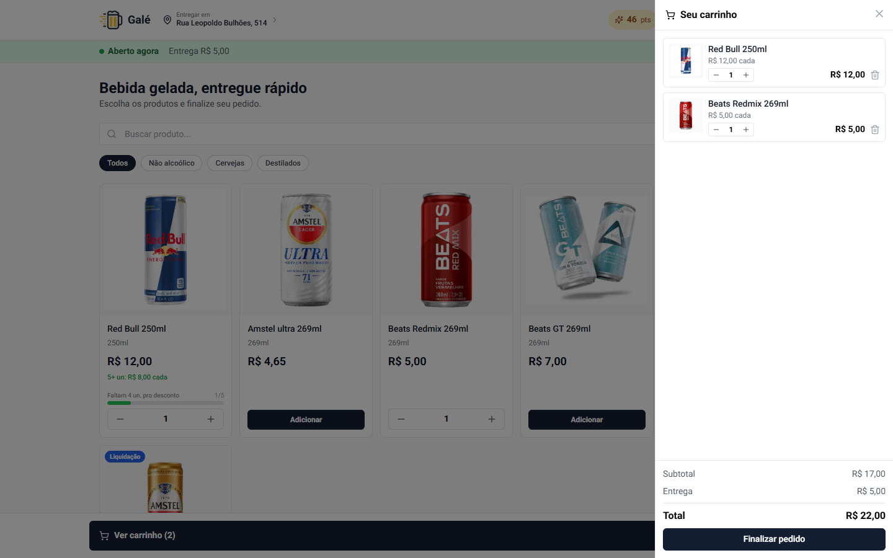 | 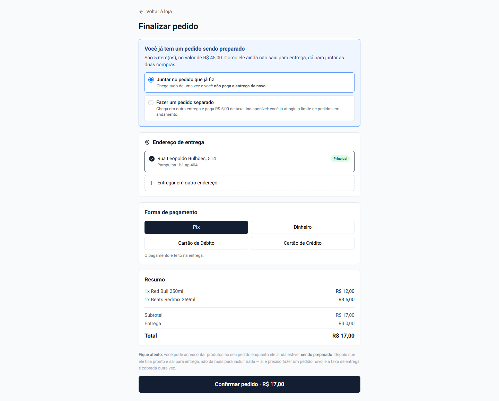 |

O carrinho fica salvo no navegador. Já o checkout concentra boa parte das regras:

- **Juntar no pedido que já fiz.** Se o cliente tem um pedido que ainda não foi montado ("Recebido" ou "Em preparação"), o checkout oferece juntar os itens novos nele, **sem cobrar a entrega de novo**, porque é a mesma viagem. Essa opção já vem marcada, por ser a mais barata para o cliente. Pedidos em "Pronto" ou "A caminho" não aceitam itens: a sacola já foi fechada ou o motoboy já saiu.
- **Fila limitada.** Cada cliente pode ter no máximo **2 pedidos de delivery em andamento**, para que ninguém lote a fila. Esse limite é separado do fiado: travar a fila por causa de dívida misturaria controle de crédito com controle de fila.
- **Endereço.** O endereço principal já vem escolhido. Sem endereço salvo, o formulário abre direto, para a tela não virar um beco sem saída. O CEP preenche rua e bairro sozinho.
- **Forma de pagamento.** O pagamento é feito na entrega. Boleto não aparece, porque não faz sentido numa entrega de bebida. A **notinha** só aparece para quem a loja autorizou e que ainda tem limite. Se o carrinho não couber no que sobrou, a tela explica em vez de simplesmente esconder a opção.
- **Pontos.** O desconto em pontos vem da cotação do servidor, para o total exibido ser exatamente o que será cobrado. Se o programa de pontos estiver fora do ar, a seção some e a compra segue normalmente.

### 3.5 Meus pedidos, minha conta e meus pontos

| Meus pedidos | Minha conta | Meus pontos |
|---|---|---|
| 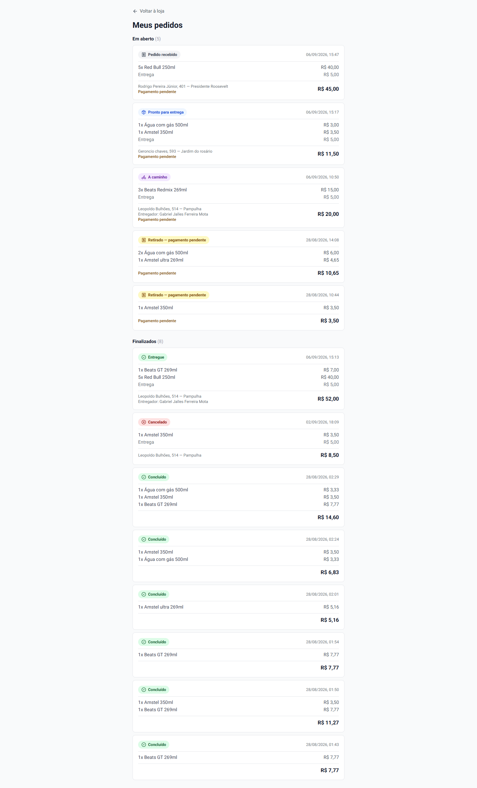 | 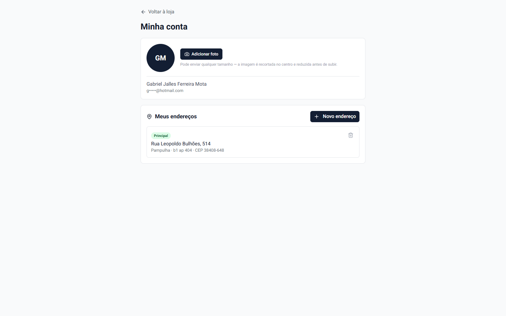 | 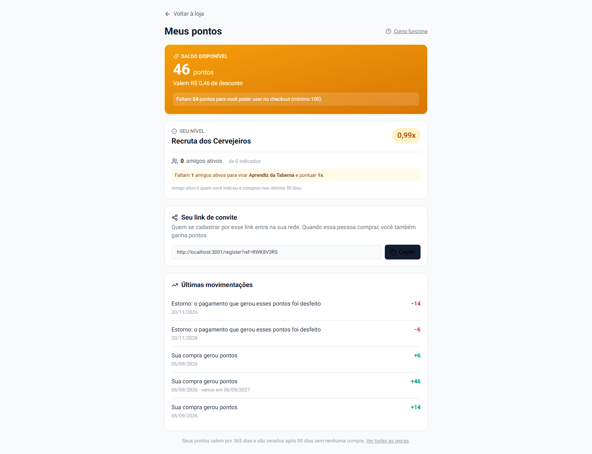 |

- **Meus pedidos:** acompanha cada pedido pela mesma etapa do Kanban da loja e mostra se o pagamento está pendente.
- **Minha conta:** foto, dados pessoais e endereços. Um dos endereços é o principal.
- **Meus pontos:** mostra o saldo e quanto ele vale em reais, o título atual e quanto falta para o próximo, o link de convite pronto para copiar e o extrato. O extrato inclui os **estornos**: um pedido cancelado devolve os pontos usados nele e desfaz os pontos que ele tinha gerado.

---

## 4. Painel administrativo

Todas as telas do Admin têm a mesma barra lateral: Resumo, Catálogo, Promoções, Pedidos, Vendas, Estoque, Usuários, Dashboard, Financeiro e Configurações.

### 4.1 Resumo: a tela do dia

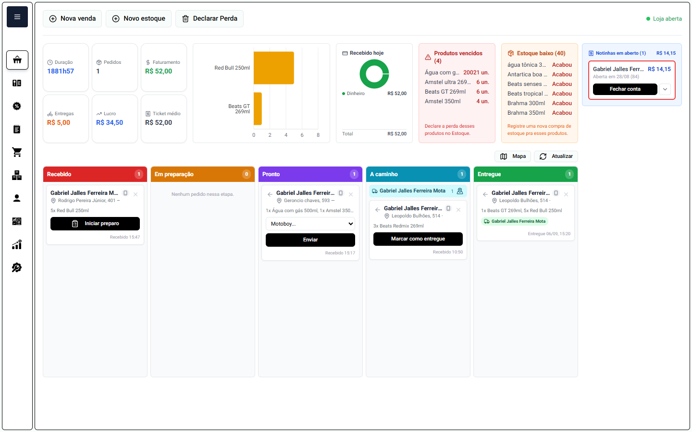

É a tela que fica aberta no balcão. Ela reúne:

- **Atalhos:** Nova venda, Novo estoque e Declarar perda, além do indicador "Loja aberta".
- **Números do dia de trabalho aberto:** duração, pedidos, faturamento, entregas (frete), lucro e ticket médio.
- **Produtos mais vendidos** do dia e **Recebido hoje** por forma de pagamento.
- **Alertas que pedem ação:** produtos **vencidos**, com o lembrete "Declare a perda desses produtos no Estoque", e **estoque baixo** (5 unidades ou menos), com "Registre uma nova compra".
- **Notinhas em aberto**, das mais antigas para as mais novas. A borda fica amarela com 30 dias ou mais e vermelha com 60 dias ou mais. O botão "Fechar conta" fica ali mesmo.
- **O Kanban de entregas do dia, embutido.**

**Por quê existe o "dia de trabalho":** ele vai do momento em que a loja abre até o momento em que fecha, manualmente ou pelo horário. Uma distribuidora de bebidas vira a madrugada, então "dia" pelo calendário cortaria o expediente no meio. Toda venda pertence a um dia de trabalho.

#### Nova venda (balcão ou delivery)

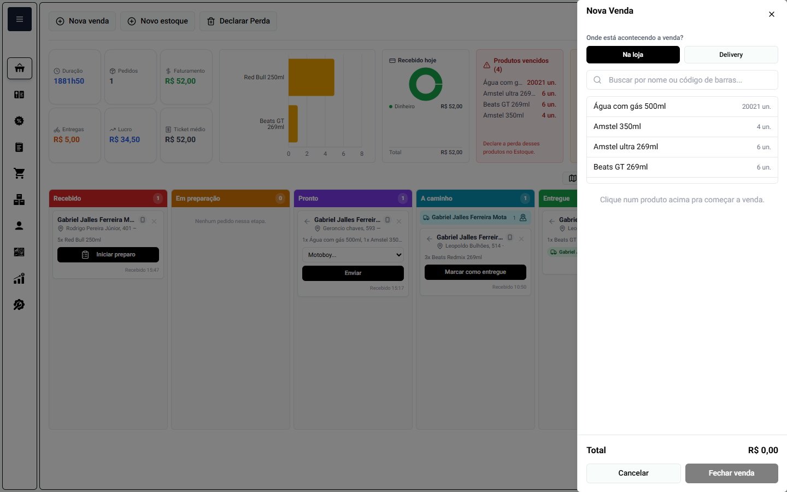

- **Onde está acontecendo a venda?** É a primeira pergunta: *Na loja* ou *Delivery*.
- **Busca de produto:** por nome ou **código de barras** (o leitor acerta o produto exato). Sem nada digitado, aparece a lista inteira, então dá para clicar sem digitar.
- **Preço:** é calculado com a mesma regra do servidor. Veja a [seção 5.1](#51-qual-preço-vale).
- **Delivery:** escolhe-se um cliente cadastrado ou marca-se a venda como **anônima**. Para um cliente, os endereços dele aparecem e o principal já vem selecionado. Os campos continuam editáveis para ajustar o complemento só daquela entrega, sem alterar o cadastro.
- **Notinha:** a venda é vinculada a um cliente. O Admin pode dar notinha a qualquer pessoa; os demais vendedores só a clientes autorizados.
- **Kanban:** a venda feita aqui entra direto em **"Em preparação"**, porque quem está no balcão já recebeu o pedido.

#### Novo estoque e Declarar perda

| Novo estoque (compra) | Declarar perda |
|---|---|
| 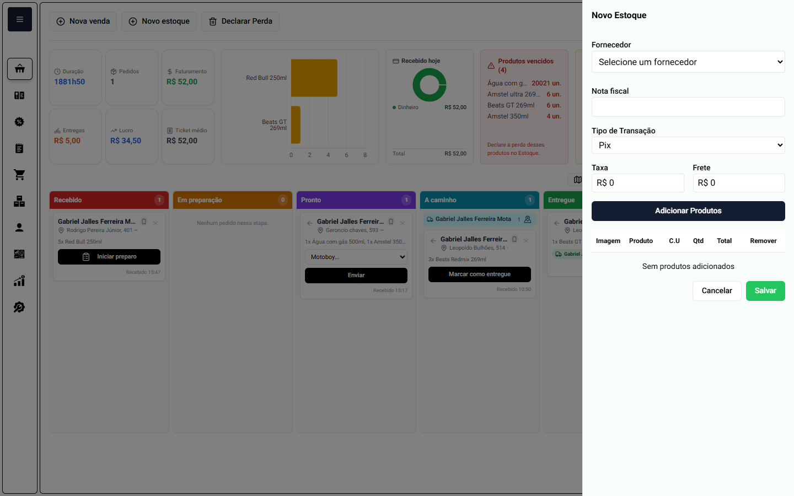 | 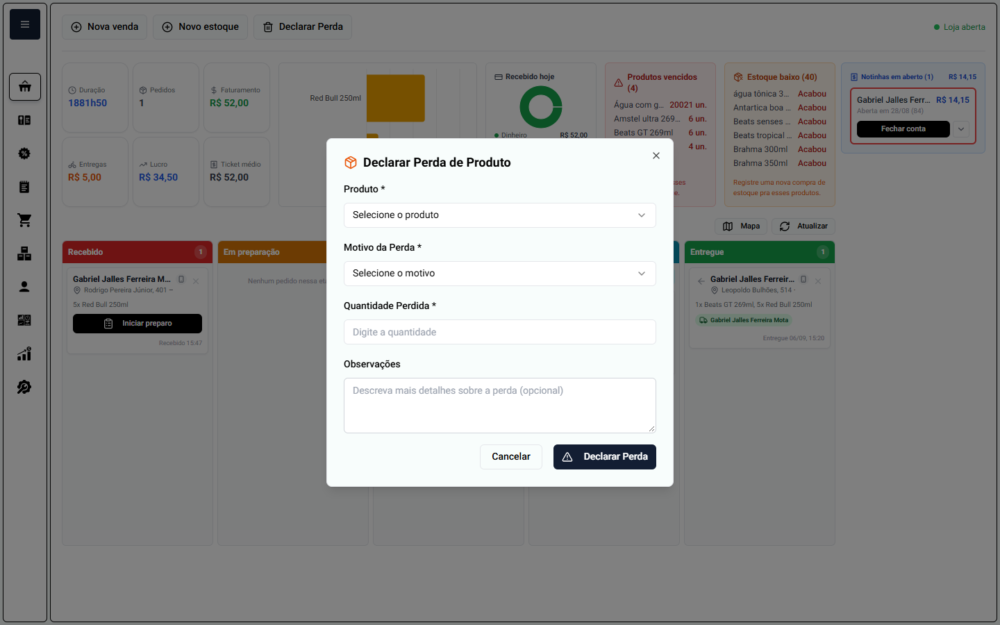 |

- **Novo estoque:** registra uma compra. Pede o fornecedor, a nota fiscal, a forma de pagamento (boleto parcelado, Pix, dinheiro…), o frete e as taxas, e os produtos com quantidade, custo unitário e **validade de cada lote**.
- **Declarar perda:** pede o produto, o motivo (*furto, avaria, vencimento ou extravio*), a quantidade e observações. Quando o motivo é vencimento, a tela filtra as validades do produto.

### 4.2 Catálogo: preços e disponibilidade

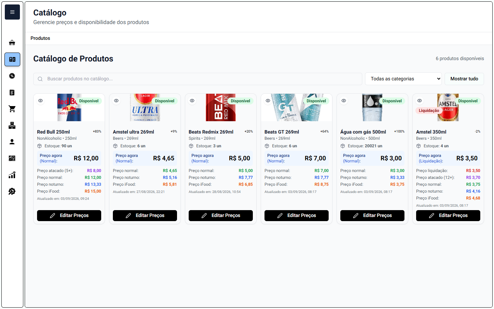

Cada card mostra:

- **Preço agora** e qual regra está valendo (Normal, Liquidação…);
- todas as tabelas de preço do produto: atacado, normal, noturno e iFood;
- o estoque atual;
- a **margem** em relação ao custo (os "+83%" e "-2%" no canto).

O olho alterna se o produto aparece na vitrine.

**Por quê:** o preço noturno e o do iFood são **pré-calculados** a partir do preço normal, usando os percentuais das Configurações. Depois disso, podem ser ajustados produto a produto. A ideia é automatizar o caso comum e deixar a exceção na mão do dono.

### 4.3 Estoque: produtos, lotes, compras e fornecedores

| Em estoque | Histórico |
|---|---|
| 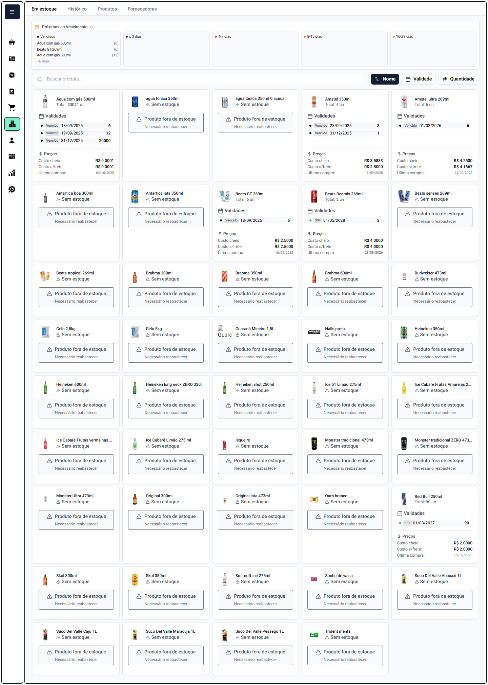 | 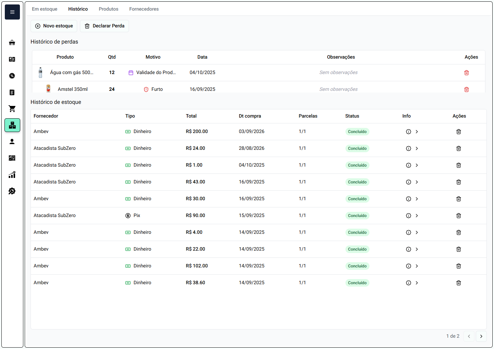 |

| Produtos | Novo produto | Fornecedores |
|---|---|---|
| 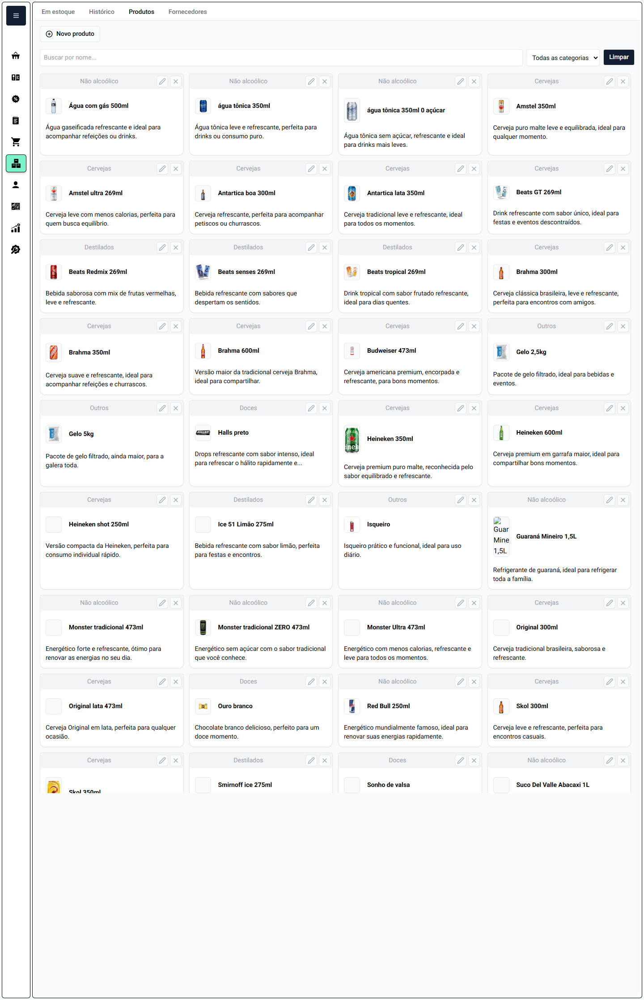 | 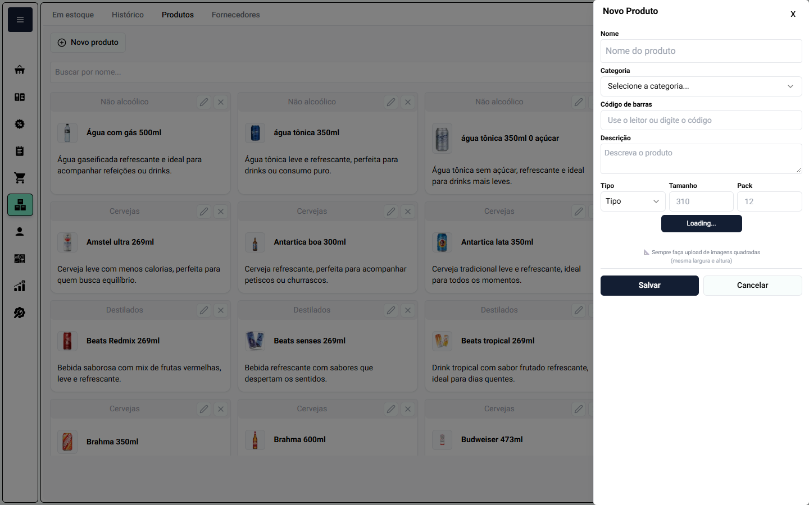 | 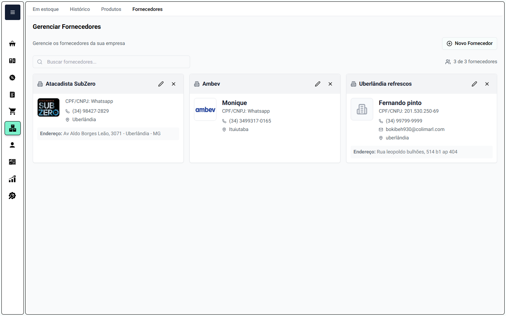 |

- **Em estoque:** cada produto com seus **lotes** e a validade de cada um, numa legenda de cores: preto = vencido, vermelho-escuro = até 3 dias, vermelho = até 7, laranja = até 15, amarelo = até 30, verde = mais de 30. Fica fácil ver o que precisa girar primeiro.
- **Histórico:** todas as compras, com tipo de pagamento, parcelas e status (pago, pendente), e todas as perdas declaradas. Uma entrada pode ser **corrigida**, seja por erro de digitação ou por ajuste após a contagem física. Quando uma compra é excluída, o sistema confere se o produto ainda tem estoque em outros lotes antes de tirá-lo da vitrine.
- **Produtos:** o cadastro-mestre, com nome, categoria, código de barras, embalagem (*pack*), tamanho e foto. A foto é redimensionada no navegador antes do upload.
- **Fornecedores:** empresa, contato, cidade e o app por onde se compra (WhatsApp, por exemplo).

**Por quê o custo é "landed":** o custo de um item não é só o preço unitário na nota. O frete e as taxas da compra são **rateados** entre os produtos, na proporção do valor de cada um, e somados ao custo unitário. É esse custo completo que vai para o lucro. Sem ele, o lucro pareceria maior do que é.

### 4.4 Pedidos: Kanban de entregas e mapa

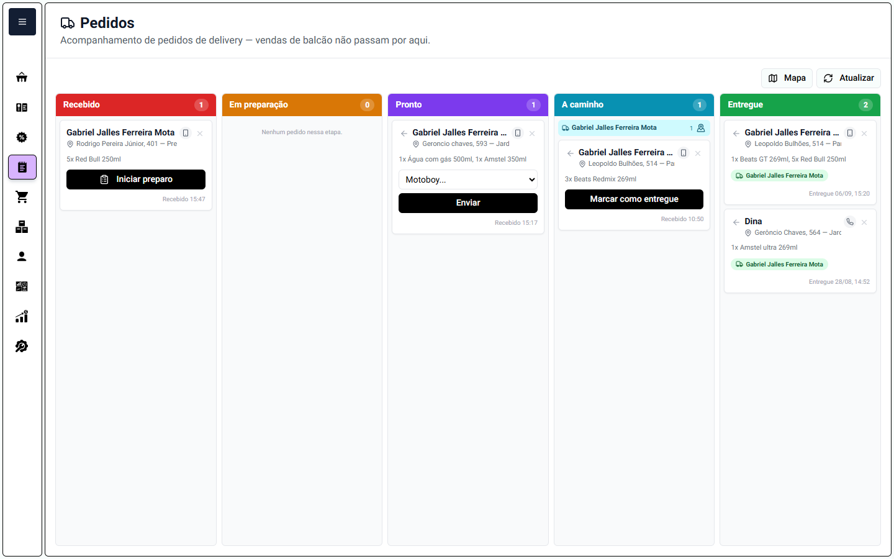

O quadro só mostra **delivery**; as vendas de balcão não passam por aqui. As etapas:

| Etapa | O que acontece |
|---|---|
| **Recebido** | O pedido chegou (do app do cliente, por exemplo). Botão "Iniciar preparo". |
| **Em preparação** | Os itens são separados com um **checklist**, um item marcado por vez. Enquanto o pedido está aqui, o cliente ainda pode acrescentar itens. |
| **Pronto** | A sacola foi fechada. Escolhe-se o **motoboy** e clica-se em "Enviar". |
| **A caminho** | Os pedidos são **agrupados por motoboy**. Botão "Marcar como entregue". |
| **Entregue** | Saiu de cena. Mostra quem entregou e quando. |

- Cada etapa tem uma **seta para voltar** e um botão para **cancelar** o pedido.
- O quadro só funciona com a loja aberta, porque não faz sentido trabalhar um delivery com a loja fechada.
- **Exército de um homem só:** é uma opção das Configurações para quando o dono toca a loja sozinho. O motoboy já vem preenchido com o próprio Admin, e basta clicar em "Enviar".

#### Mapa de entregas

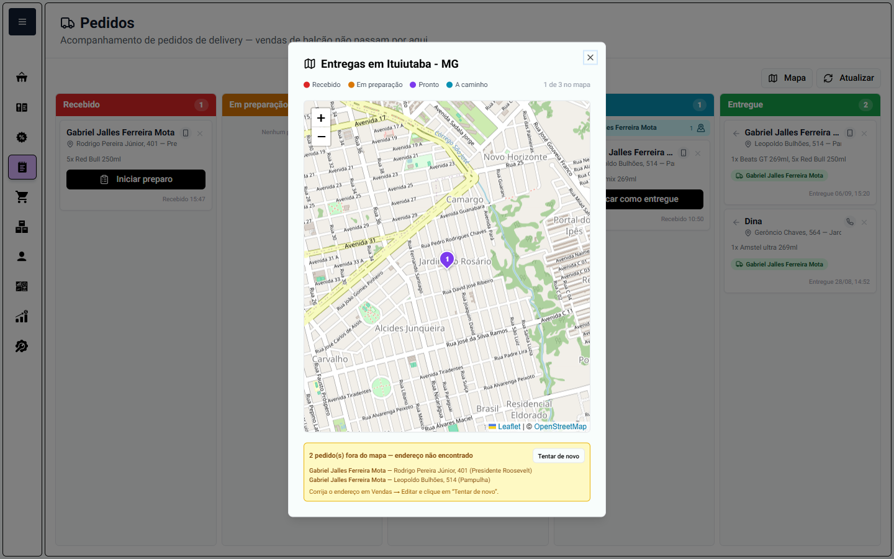

O botão **Mapa** abre as entregas ativas sobre o mapa da cidade configurada (OpenStreetMap, via Leaflet). **A cor de cada pino é a cor da etapa no Kanban**, então o mapa e o quadro falam a mesma língua. Clicar no pino fecha o mapa e leva até o card do pedido, que fica destacado.

**Como os endereços viram pontos no mapa:**

- Os pedidos guardam só rua, número e bairro. A cidade e o estado vêm das Configurações.
- A busca tenta da forma mais específica para a mais frouxa: endereço completo, depois **CEP** (que acerta o quarteirão) e depois só rua e cidade. Em cidades menores, o OpenStreetMap costuma ter a rua mapeada, mas não o número da casa, e cair para "rua + cidade" ainda separa bem as entregas.
- O tipo de logradouro é recolocado antes da busca, porque "vinte e um" não acha nada e "Avenida vinte e um" acha.
- O que não for encontrado aparece numa faixa amarela, **"pedido(s) fora do mapa — endereço não encontrado"**, com um botão "Tentar de novo". Isso aparece no print acima.

**Rota do motoboy:** na coluna "A caminho", o sistema monta a rota no Google Maps com todas as paradas daquele motoboy. As paradas são ordenadas pelo **vizinho mais próximo**: começa na primeira entrega e vai sempre para a mais perto que ainda falta, usando a distância geográfica (fórmula de Haversine). Não é a rota ótima, que seria o problema do caixeiro-viajante, mas encurta bastante o trajeto em relação à ordem de chegada dos pedidos. A origem fica em branco de propósito: o Google usa a localização de quem abre o link, ou seja, o próprio entregador no celular.

### 4.5 Vendas: todas as vendas e seus tipos

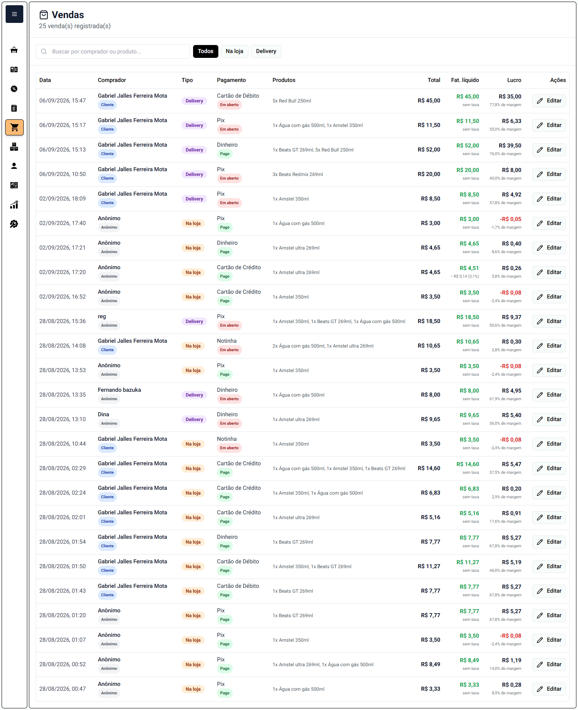

É a lista de todas as vendas, com filtro **Todos / Na loja / Delivery** e busca por comprador ou produto. Cada linha mostra três valores:

- **Total:** o valor bruto cobrado do cliente.
- **Faturamento líquido:** o que sobra depois da taxa da maquininha. Por exemplo, "– R$ 0,14 (3,1%)" no crédito.
- **Lucro:** o líquido menos o custo das mercadorias, com a **margem em %**. A margem negativa aparece em vermelho, e isso salta aos olhos quando um produto em liquidação está saindo abaixo do custo.

O botão "Editar" corrige uma venda (endereço, forma de pagamento…). O CEP preenche a rua.

#### Os tipos de venda

| Dimensão | Valores | Observação |
|---|---|---|
| **Onde** | **Na loja** (balcão) · **Delivery** | Só o delivery passa pelo Kanban e paga frete. |
| **Quem compra** | **Cliente** cadastrado · **Anônimo** | O anônimo não acumula pontos. Uma entrega anônima guarda o nome de quem recebe. |
| **Origem** | App · WhatsApp · Instagram · Ligação · Loja · iFood | A venda do iFood usa o preço com a comissão embutida. |
| **Pagamento** | Dinheiro · Pix · Débito · Crédito · **Notinha** | Boleto existe só nas compras de estoque. |
| **Status do pagamento** | **Pago** · **Em aberto** | O delivery nasce "em aberto" (paga na entrega); a notinha fica em aberto até fechar a conta. |

**A notinha (fiado):**

- Só compra fiado quem foi **autorizado** em Usuários, e até um **limite** de valor. O limite padrão é configurável, e cada cliente pode ter o seu.
- O limite é checado no último momento, quando o total final já é conhecido, com frete. Se estourar, a venda inteira é desfeita, **inclusive a baixa de estoque**.
- Ao **fechar a conta**, escolhe-se a forma de pagamento real. Se houver **juros por atraso**, eles são somados à notinha mais antiga e aparecem separados nos relatórios.
- O faturamento da notinha conta **no dia em que foi paga**, e não no dia em que o produto saiu. É regime de caixa.

### 4.6 Promoções: o programa de pontos por dentro

| Saúde do programa | Simulador |
|---|---|
| 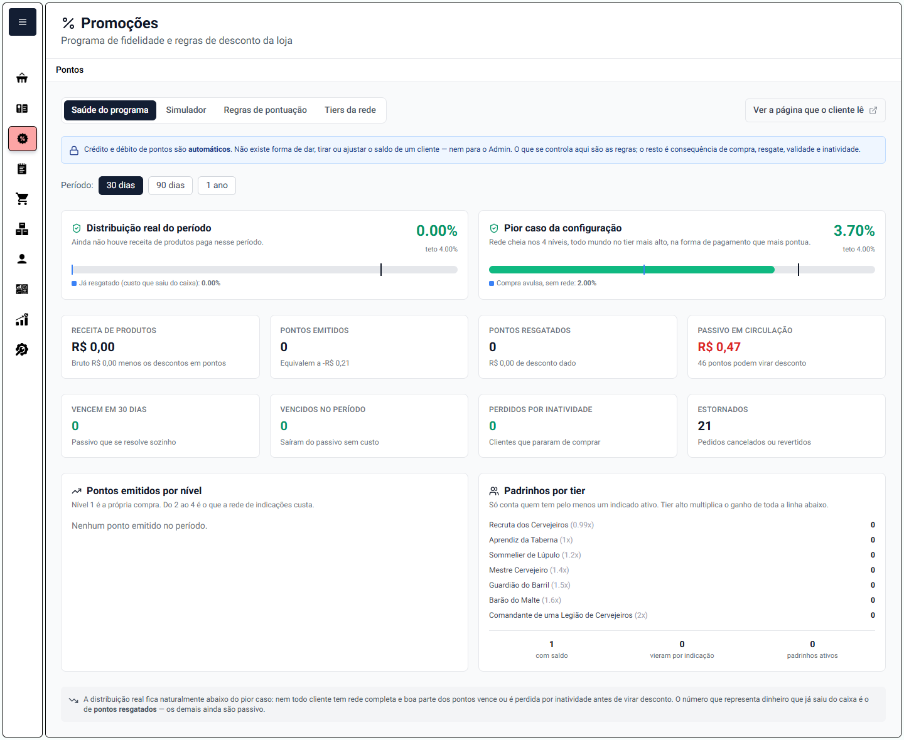 | 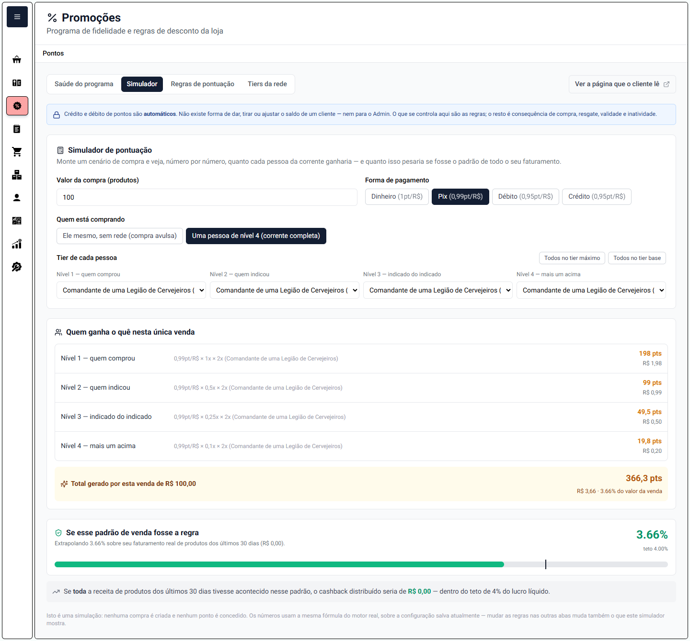 |

| Regras de pontuação | Tiers da rede |
|---|---|
| 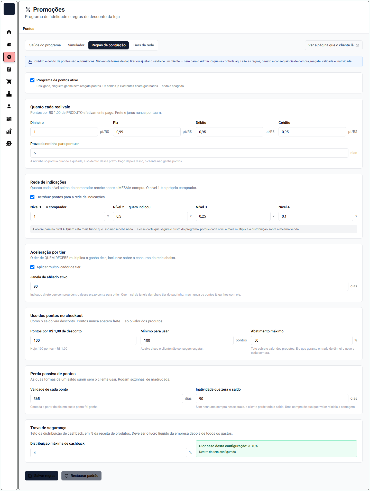 | 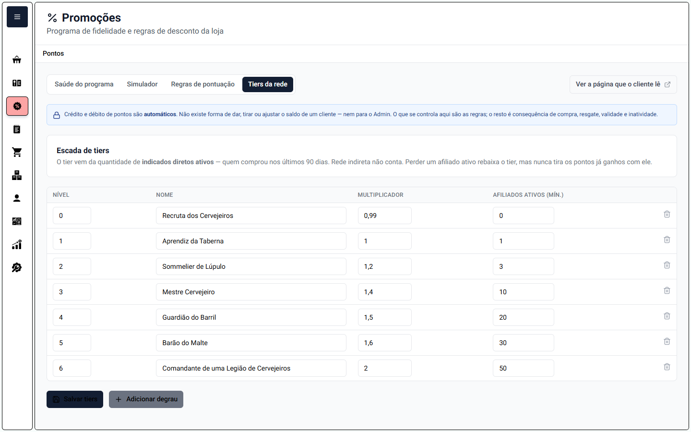 |

O aviso no topo diz tudo: **"Crédito e débito de pontos são automáticos. Não existe forma de dar, tirar ou ajustar o saldo de um cliente — nem para o Admin."** O que se controla são as regras; o saldo é consequência de compra, resgate, validade e inatividade. Isso fecha a porta para fraude e para favorecimento.

- **Saúde do programa:** compara a **distribuição real** do período com o **pior caso da configuração** e com o teto. Também mostra o **passivo em circulação**, isto é, os pontos que ainda podem virar desconto, e quantos pontos vencem, foram perdidos ou estornados.
- **Simulador:** escolhe-se um valor, a forma de pagamento, a profundidade da rede e o título de cada pessoa. O simulador mostra quanto cada nível ganharia e quanto isso pesaria se fosse o padrão do faturamento. Ele usa a mesma fórmula do motor real, mas não cria compra nem concede ponto.
- **Regras de pontuação:**
  - pontos por real em cada forma de pagamento;
  - prazo da notinha para pontuar (5 dias);
  - multiplicadores da rede (1 / 0,5 / 0,25 / 0,1);
  - janela de afiliado ativo (90 dias);
  - conversão e limites do resgate;
  - validade e inatividade;
  - a **trava de segurança**.
- **Tiers da rede:** a escada de títulos. O sistema exige que ela **suba**: um degrau mais alto pedindo menos amigos tornaria o degrau de baixo inalcançável.

**O raciocínio do custo do programa:**

- **Dinheiro pontua mais que cartão.** Quanto mais caro é receber naquela forma de pagamento, menos pontos ela dá, e assim o programa empurra o cliente para a forma mais barata para a loja.
- **A rede para no nível 4.** Cada nível a mais multiplica a distribuição sobre a mesma venda, e esse corte é o que segura o custo.
- **A notinha só pontua se for quitada dentro do prazo.** Senão, o programa financiaria a inadimplência.
- **O que é pago com pontos não gera pontos de novo.** Os pontos também nunca abatem o frete, e abatem no máximo 50% dos produtos, o que garante a entrada de dinheiro novo em cada compra.
- **A trava do teto.** Ela calcula o pior caso: rede cheia, todo mundo no título mais alto, na forma de pagamento que mais pontua. Se esse pior caso passar do teto (por padrão 4%, que deve representar o lucro líquido da empresa), o sistema **bloqueia o salvamento** e mostra os números. Para salvar mesmo assim, é preciso confirmar que viu o aviso. A trava não corta o ganho de ninguém no meio da compra, porque o cliente veria menos do que a página pública prometeu.

### 4.7 Usuários

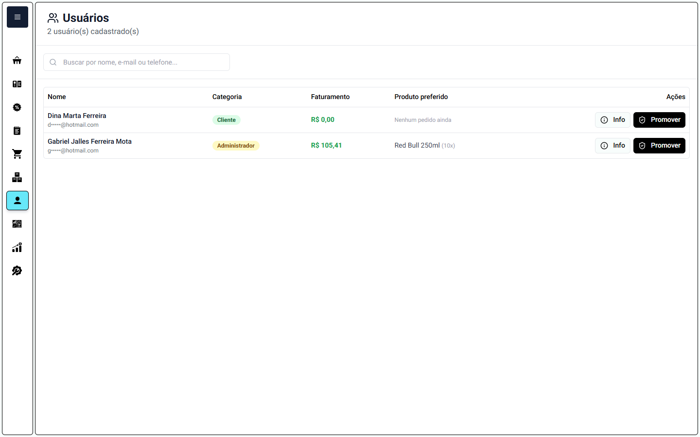

Mostra a lista de clientes com categoria, faturamento total e **produto preferido**. Para cada um:

- **Info:** dados, endereços e pedidos.
- **Crédito de notinha:** autorizar ou não e definir o limite. O campo de limite fica **vazio** quando a pessoa usa o padrão da loja. Assim dá para distinguir "R$ 200 porque é o padrão" de "R$ 200 porque alguém decidiu R$ 200 para ela". Uma barra mostra quanto do limite já está em uso.
- **Promover:** muda o papel da pessoa (Cliente, Vendedor, Entregador, Admin). Ninguém se cadastra como Admin pelo site.

### 4.8 Dashboard

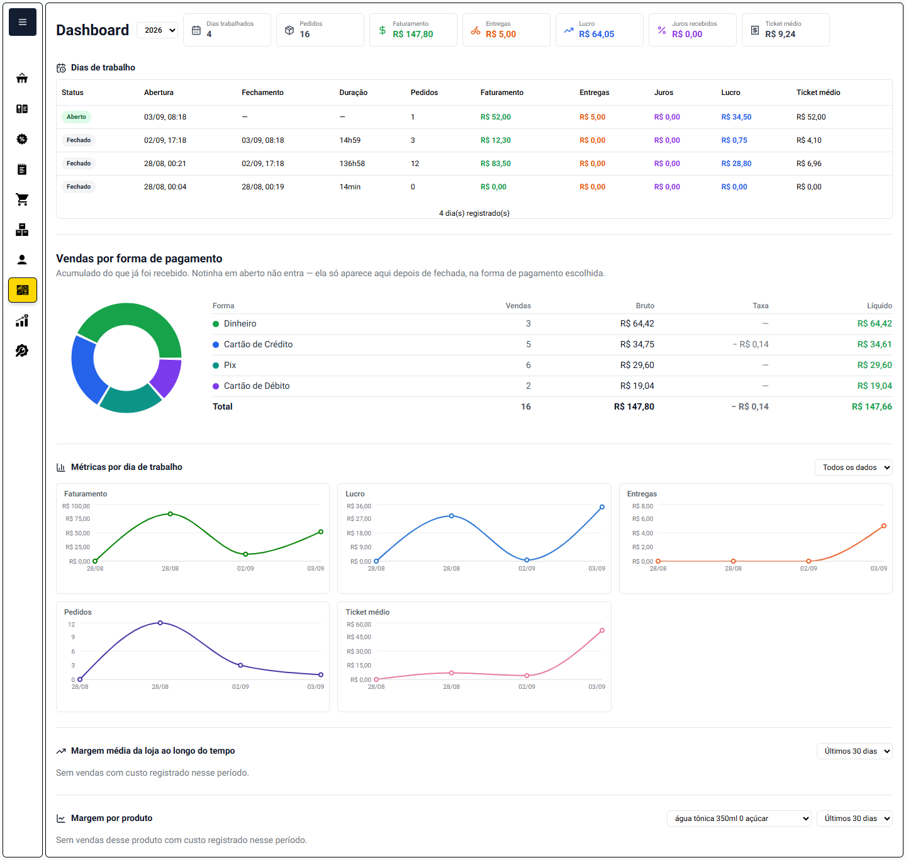

- **Totais do ano:** dias trabalhados, pedidos, faturamento, entregas, lucro, juros recebidos e ticket médio. O ticket médio é o faturamento total dividido pelo total de pedidos, e não a média das médias diárias, que distorceria o resultado.
- **Dias de trabalho:** abertura, fechamento, duração e números de cada expediente.
- **Vendas por forma de pagamento:** bruto, taxa e líquido. A notinha em aberto não entra; ela aparece aqui só depois de fechada, na forma de pagamento escolhida.
- **Gráficos por dia de trabalho:** faturamento, lucro, entregas, pedidos e ticket médio.
- **Margem da loja ao longo do tempo** e **margem por produto.** Esta última mostra o preço de venda contra o custo num gráfico e a margem % noutro, alinhados pelos mesmos dias, porque são escalas diferentes.

### 4.9 Financeiro: DRE e despesas fixas

| DRE | Despesas fixas |
|---|---|
| 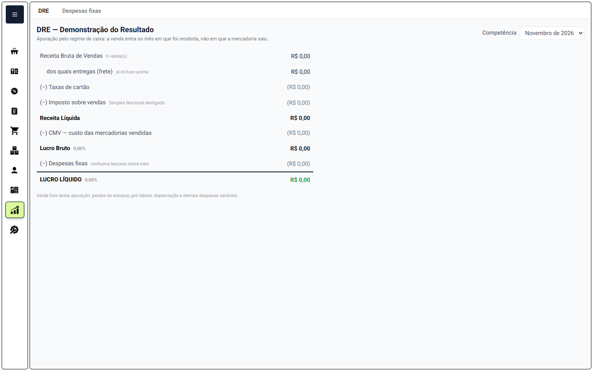 | 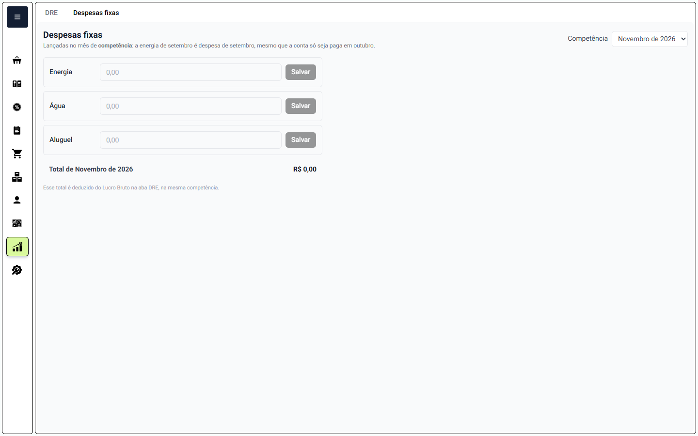 |

A **DRE (Demonstração do Resultado)** de cada mês segue a ordem:

1. Receita bruta (dos quais frete)
2. − taxas de cartão
3. − imposto sobre vendas
4. = **receita líquida**
5. − CMV (custo das mercadorias vendidas)
6. = **lucro bruto**
7. − despesas fixas
8. = **lucro líquido**

Algumas decisões importantes:

- **Regime de caixa:** a venda entra no mês em que foi **recebida**, e não no mês em que a mercadoria saiu.
- **O imposto só entra aqui, nunca na venda individual.** A alíquota efetiva do Simples Nacional depende da receita acumulada dos últimos 12 meses (RBT12), que só existe olhando o conjunto: `alíquota efetiva = (RBT12 × alíquota nominal − parcela a deduzir) / RBT12`.
- **Com o Simples desligado, a linha do imposto continua visível, zerada.** Assim fica claro que foi uma escolha, e não um esquecimento.
- **O que ainda fica de fora**, e está escrito na própria tela: perdas de estoque, pró-labore, depreciação e despesas variáveis.

### 4.10 Configurações

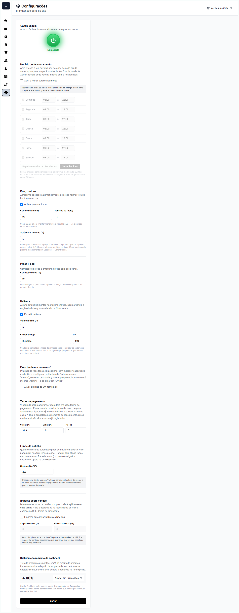

Um painel só com tudo que muda o comportamento da loja:

- **Status da loja:** o botão grande liga e desliga a loja.
- **Horário de funcionamento:** uma grade semanal que abre e fecha a loja sozinha. Um horário que fecha antes de abrir (das 20h às 4h) cruza a madrugada. Uma **intervenção manual** vale por cima da grade, para fechar num dia normal ou abrir num feriado, e **expira sozinha** na próxima virada da grade, para ninguém esquecer a loja travada.
- **Preço noturno:** liga/desliga, horário (das 23h às 7h) e acréscimo (5%).
- **Preço iFood:** a comissão embutida (27%).
- **Delivery:** liga/desliga, valor do frete e cidade/UF, que servem para o mapa e para as rotas.
- **Exército de um homem só.**
- **Taxas de pagamento** de crédito, débito e Pix. A taxa é **congelada no momento do recebimento**, então mudar o valor aqui não altera vendas já registradas.
- **Limite padrão da notinha:** ao atingir o limite, a opção some do checkout do cliente e volta sozinha quando a conta é quitada.
- **Imposto sobre vendas:** Simples Nacional, com alíquota nominal e parcela a deduzir.
- **Distribuição máxima de cashback:** é o teto da trava do programa de pontos.
- **"Ver como cliente":** abre a vitrine para conferir o resultado.

---

## 5. Regras de negócio em detalhe

### 5.1 Qual preço vale

A mesma ordem de prioridade é usada no servidor (`pricing.utils.ts`) e na prévia da tela:

```
iFood  >  Liquidação  >  Atacado (quantidade mínima)  >  Noturno  >  Normal
```

- **iFood** ganha de tudo, porque a comissão precisa estar embutida no preço daquele canal.
- **Liquidação** é o preço para girar um lote.
- **Atacado** é um valor fixo negociado por quantidade. Ele **não tem versão noturna** e vale em qualquer horário. O atacado pode ser desligado sem apagar os valores configurados.
- **Noturno** vale dentro da janela configurada, que pode cruzar a meia-noite.

### 5.2 Estoque FIFO e custo real

- A venda baixa o estoque **dos lotes mais antigos primeiro**. Isso também diminui a chance de deixar produto vencer.
- Cada item vendido guarda o custo (`landedUnitCost`) dos lotes que realmente saíram. O lucro é sempre o preço de venda menos esse custo.
- O custo é alinhado por linha do pedido, e não por produto, para não colidir quando o mesmo produto aparece duas vezes.
- Se qualquer etapa da venda falhar (limite da notinha, resgate de pontos), a transação inteira é desfeita, **e o estoque volta**.

### 5.3 Quando os pontos são creditados

- A venda de balcão paga na hora pontua na hora.
- A **notinha** e o **delivery** nascem sem pagamento e só pontuam quando o dinheiro entra: no fechamento da conta ou na entrega.
- Os pontos guardam 4 casas decimais, porque 0,95 ponto numa compra pequena sumiria se fosse arredondado antes.
- A validade e a inatividade são aplicadas por rotinas automáticas de madrugada (4h e 5h), em lotes, para que uma virada de ano com muitos pontos vencendo não trave o banco numa transação gigante.

---

## 6. Tecnologia e como rodar

| Camada | Tecnologia |
|---|---|
| Frontend | Next.js 15 (App Router), React 18, TypeScript, Tailwind CSS, Radix UI/shadcn, React Hook Form + Zod, Recharts, Leaflet (mapa), UploadThing (imagens) |
| Backend | NestJS 11, Prisma ORM, PostgreSQL (Neon), JWT + Passport (papéis Admin/Shopper/DeliveryMan/Client), `@nestjs/schedule` (rotinas de abertura e fechamento e de pontos), Nodemailer + Handlebars (e-mails) |
| Integrações | ViaCEP (endereço pelo CEP), Nominatim/OpenStreetMap (localizar endereços no mapa), Google Maps (rota do motoboy) |

```
gale-backend/    API NestJS (auth, catalog, order, stock, points, finance, reports, settings, work-day, user…)
gale-frontend/   Next.js (vitrine, área do cliente e painel /admin)
docs/            prints das telas e anotações de desenvolvimento
```

### Rodando localmente

```bash
# Backend (porta 3000 por padrão; PORT muda)
cd gale-backend
npm install
npx prisma migrate deploy   # aplica as migrations no banco do DATABASE_URL
npm run start:dev

# Frontend
cd gale-frontend
npm install
npx next dev -p 3001        # NEXT_PUBLIC_API_PORT aponta para a porta do backend
```

Variáveis do backend (`gale-backend/.env`): `DATABASE_URL`, `JWT_SECRET`, `JWT_EXPIRATION`, `FRONT_URL_SITE`, `MAIL_HOST`, `MAIL_PORT`, `MAIL_USER` e `MAIL_PASS`.

---

*Anotações de desenvolvimento (DRE, perguntas ao cliente, pendências) ficam em [`docs/anotacoes.md`](docs/anotacoes.md).*
